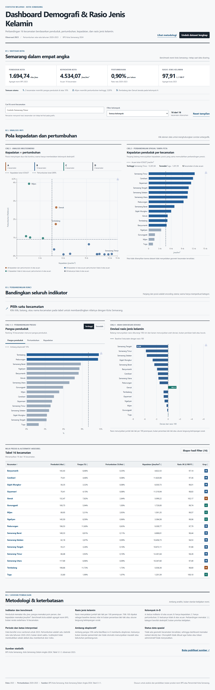

# Dashboard Demografi Kota Semarang

Dashboard React + Vite untuk mengeksplorasi penduduk, pangsa, pertumbuhan, kepadatan, dan rasio jenis kelamin 16 kecamatan Kota Semarang. Data observasi 2023; pertumbuhan adalah rata-rata tahunan 2020–2023.



## Pertanyaan yang dijawab

1. Tembalang dan Pedurungan memiliki pangsa penduduk di atas 10%.
2. Mijen memiliki pertumbuhan tertinggi; Gajah Mungkur, Candisari, dan Gayamsari berbagi nilai minimum.
3. Dua belas kecamatan lebih padat dari benchmark kota; Semarang Timur tertinggi.
4. Semarang Tengah memiliki deviasi rasio jenis kelamin absolut terbesar dari 100.
5. Tembalang dan Genuk berada pada kelompok A (kepadatan dan pertumbuhan di atas benchmark kota).

## Menjalankan proyek

```bash
npm install
npm run data:audit
npm run data:prepare
npm run data:validate
npm run dev
```

Quality gate:

```bash
npm run lint
npm run test
npm run build
npm run preview
npm run test:e2e
```

## Struktur utama

- `dataset/`: CSV asli pengguna, read-only.
- `scripts/`: audit, normalisasi, derivasi, dan validasi.
- `data/processed/`: JSON kanonik runtime.
- `src/components/`: scorecards, filter, ECharts SVG, detail, dan tabel.
- `src/data/`: loader, runtime validator, dan selectors.
- `tests/`: unit, component, dan Playwright browser tests.
- `docs/`: audit data, dictionary, spesifikasi visual, test report, dan deployment.

## Interaksi

- Search mencari dan menyorot kecamatan tanpa menghilangkan konteks seluruh kecamatan pada grafik; tabel menampilkan hasil pencarian.
- Filter A–D menyaring chart dan tabel, tanpa mengubah benchmark scorecard kota.
- Klik titik, bar, atau nama tabel menghubungkan selection ke panel detail.
- Comparison chart memakai tab yang mudah ditemukan untuk berganti antara pangsa, pertumbuhan, dan kepadatan, serta dapat diurutkan naik/turun.
- Panel detail membandingkan nilai kecamatan terpilih dengan agregat atau benchmark Kota Semarang.
- Unduh dataset lengkap selalu menghasilkan 16 record; ekspor hasil filter hanya memuat subset yang sedang tampil. CSV memakai BOM UTF-8 dan unit/periode pada header.

## Data dan metodologi

Sumber: BPS Kota Semarang, *Kota Semarang Dalam Angka 2024*, Tabel 3.1.1. CSV lokal berbeda dari oracle laporan pada 62 field, termasuk nilai pertumbuhan. Berdasarkan keputusan implementasi yang disetujui, dashboard memakai ground truth §2.7 `DASHBOARD_PLAN.md`; CSV asli tetap utuh dan semua discrepancy tersimpan di `data/metadata.json` serta [audit data](docs/DATA_AUDIT.md).

Benchmark kota resmi tidak dihitung sebagai rerata 16 kecamatan. Kelompok A–D memakai perbandingan `>` terhadap kepadatan `4.534,07` dan pertumbuhan `0,90`; klasifikasi ini eksploratif, bukan standar kebijakan.

## Known limitations

- Dataset bersifat cross-sectional; tidak ada line chart atau klaim tren tahunan.
- Tidak ada geometri kecamatan tervalidasi; density bar digunakan dan choropleth tidak diimplementasikan.
- Dashboard bukan prediksi, risk score, rekomendasi kebijakan, atau produk resmi BPS/Pemkot.
- User acceptance testing dengan responden eksternal belum dilakukan; protokol ada pada `DASHBOARD_PLAN.md`.

Lihat [deployment](docs/DEPLOYMENT.md) untuk konfigurasi Cloudflare Pages dan static host lain.
